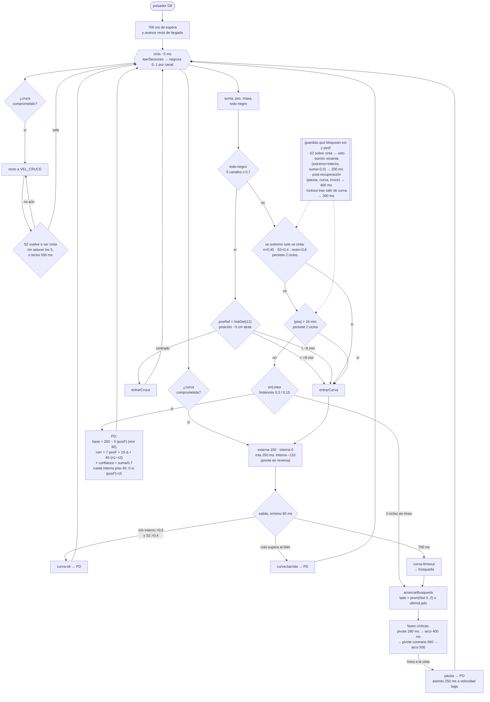

# Flujo de Arturito v3 en pista

Máquina de estados del firmware tal como corre hoy, generada desde
`firmware/arturito_v3/arturito_v3.ino` (commit `2ddf01b`). El loop
completo tarda ~5 ms; en cada pasada decide una sola cosa y manda
un solo par de comandos de motor.

## Lectura del flujo

El programa tiene cuatro modos: **PD** (el normal), **curva
comprometida** (giro fijo con tres salidas), **cruce comprometido**
(recto ciego acotado) y **búsqueda** (patrón de barbijo: pivote,
arco, pivote contrario, arco). Todo compromiso se toma una sola vez
por evento y no se repite hasta probar línea.

### Qué sostiene el diseño

- El PD es la respuesta por defecto; los giros comprometidos solo se
  disparan con evidencia específica (extremo solo, centroide corrido,
  todo-negro con memoria). El resto del tiempo la corrección es
  proporcional y guiada.
- La memoria `hist` congela la posición de la línea antes de cada
  evento — es lo que distingue esquina de cruce en el todo-negro y
  el lado por el que arranca la búsqueda.
- Las guardias apilan contexto sobre los disparos: veto si la punta
  ve cinta (brazos de la X), veto si acaba de ver un borrón (extremo
  + interior a la vez), pausa post-recuperación de 400 ms y lockout
  de 300 ms entre curvas.
- La curva comprometida ya no es ciega del todo: sale por `curva-ok`
  cuando la línea vuelve al trío y por `curva-barrida` cuando la masa
  cruza al lado contrario — esa segunda salida es la que evita que un
  giro equivocado se convierta en reversa.

### Las costuras donde falla

- **Todo giro comprometido apuesta a oscuras.** `ext` y `posf` se
  disparan con dos ciclos de evidencia y no hay forma local de saber
  si un extremo solo es la línea yéndose o un borde de cinta ajena —
  las guardias acotan los casos conocidos pero un contexto nuevo
  siempre puede gatillar uno falso.
- **`posf` dispara con `suma > 0,3`.** En rescate o con masa
  marginal, una negrura de ~0,35 en un extremo ya empuja el
  centroide más allá de ±16 mm (corrida #19). La candidata pendiente
  es exigir masa mínima en el lado del disparo.
- **La búsqueda no tiene techo.** Las fases de pivote y arco se
  repiten para siempre; en un piso blanco grande el robot deriva
  hasta salir del tablero. No hay "rindiéndose" ni límite de
  desplazamiento.
- **`curva-ok` pide trío + S2.** Si la línea vuelve por el borde
  equivocado o queda flaca, la única salida es `barrida` (necesita
  masa del lado contrario) o el timeout de 700 ms — el segundo
  siempre termina en búsqueda.
- **La banda de confianza corta la corrección por la mitad con
  `suma` ≈ 0,35.** En una curva real donde la cinta se adelgaza al
  salir por un extremo, el PD responde más suave justo cuando el
  compromiso aún no disparó — puede pasarse de largo una esquina
  tímida.

### Ideas abiertas para la próxima revisión

1. **Masa mínima en el lado del disparo** para `posf` (y quizá
   `ext`): el par de canales del lado que gatilla debe superar
   ~0,5 — los asomos de 0,3-0,4 no comprometen.
2. **Centroide del trío interno durante masa ancha**: si un cruce
   desvía el PD hacia el brazo, excluir los extremos del cómputo de
   posición mientras dure la ventana de masa.
3. **Límite de deriva en búsqueda**: si ninguna fase encuentra línea
   en ~3-4 s, detener o ralentizar el patrón en vez de seguir
   barriendo.
4. **Salida adicional de curva por "línea vista al frente"**: hoy
   solo hay ok / barrida / timeout; una salida si S2 vuelve a ver
   cinta sin exigir el trío completo podría cortar giros que
   funcionaron pero no completan la confirmación.
